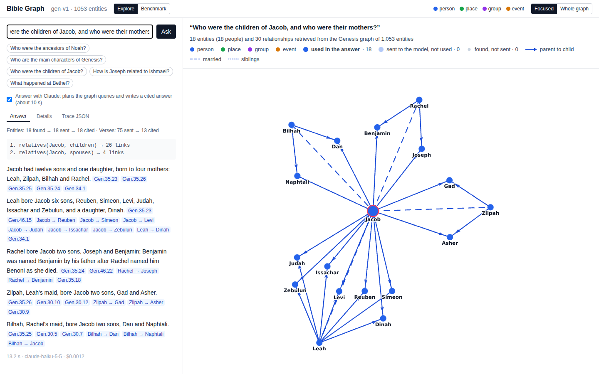
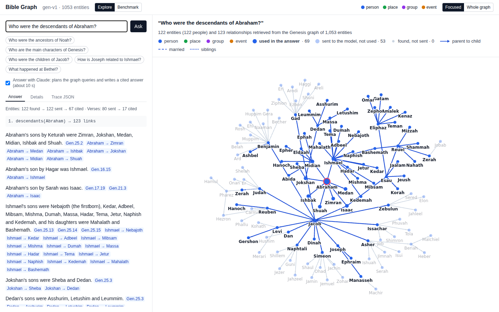
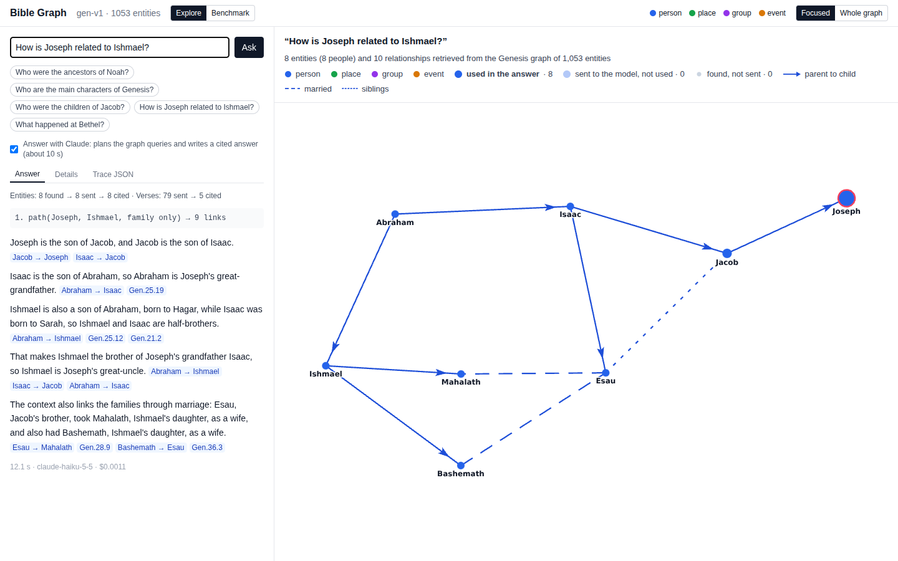
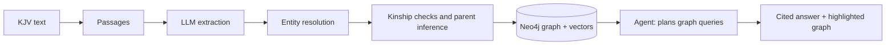

# Bible Graph RAG

Ask a question about the Bible and see the evidence. A small agent queries a knowledge graph built from the King James text, every sentence of the answer cites its verses, and the graph view lights up exactly which people, places and events the answer used.

A hobby project, built for learning and fun. It covers **Genesis** so far.



## What you can ask

| Question | What you see |
|---|---|
| Who were the ancestors of Noah? | The line back to Adam and Eve, drawn as a tree, every link cited to Genesis 5 |
| Who were the descendants of Abraham? | 122 people drawn as rings around Abraham |
| Who were the children of Jacob, and who were their mothers? | Twelve sons and Dinah, each linked to Leah, Rachel, Bilhah or Zilpah |
| How is Joseph related to Ishmael? | Both routes: Ishmael is Joseph's great-uncle, and Esau married Ishmael's daughters |
| Who are the main characters of Genesis? | The 15 most named people and the links among them |
| What happened at Bethel? | Abram's altar, Jacob's dream and vow, the renaming from Luz |

In the graph, bright items are used in the answer, faded items were sent to the model but not used, and small grey dots were found but cut by ranking. A caption at the top of the graph gives the counts and the key, so a screenshot of the graph explains itself.

| Abraham's descendants | How Joseph is related to Ishmael |
|---|---|
|  |  |

## Results

The graph was built entirely by an LLM reading Genesis: 1,053 entities (335 people, 100 places, 36 groups, 582 events) and 2,237 relationships, for about $1.20 of Claude Haiku.

**Graph quality**, scored against [Theographic Bible Metadata](https://github.com/robertrouse/theographic-bible-metadata), a free hand-made Bible dataset used only as the answer key, never as input:

| Measure | Score |
|---|---|
| Entity resolution (B³ F1) | 98.3% |
| Father-child links (F1) | 94.8% (precision 97.8%) |
| Mother-child links (F1) | 84.3% |
| Hard name cases (two Lamechs, Abram = Abraham, Jacob = Israel…) | 6 of 6 |

**Answer quality** on 40 Genesis questions. Same model and prompt in every column; only the retrieval differs. Graded by a stronger model against reference answers.

| Measure | Graph agent | Vector RAG | LLM from memory |
|---|---|---|---|
| Accuracy | 92.5% | 61% | 92.5% |
| Ancestor and descendant lists | 85% | 60% | 75% |
| People named in long family lists | 95% | 66% | 78% |
| Sentences backed by the verses they cite | 92% | 94% | 0% |

Claude knows Genesis almost by heart, so on plain accuracy answering from memory ties the graph agent. The graph adds the drawn family structure, complete long lists, and answers you can check verse by verse. Answers take about 13 seconds and cost about $0.002 each.

## Try it

You need Docker, Node 24 with pnpm (`corepack enable`), Python 3.12+ with [uv](https://docs.astral.sh/uv/), and an LLM: either the [Claude Code](https://docs.claude.com/en/docs/claude-code) CLI logged in, or any OpenAI-compatible endpoint (see below).

```bash
git clone https://github.com/lsampaiorocha/bible-graph-rag.git
cd bible-graph-rag
cp .env.example .env              # set NEO4J_PASSWORD (8+ characters) and your LLM settings
docker compose up -d --wait        # Neo4j on localhost:7474

cd pipeline
uv run kgrag corpus fetch          # download the KJV text
uv run kgrag corpus build          # split it into passages
uv run kgrag extract --scope Gen   # the LLM reads Genesis (about $1.20 with Claude Haiku; asks before spending over $1)
uv run kgrag build --scope Gen --resolver v1
uv run kgrag embed --index gen-v1
uv run kgrag neo4j-load --index gen-v1
cd ..

pnpm install
pnpm --filter @kgrag/api start     # API on localhost:8787 (separate terminal)
pnpm --filter @kgrag/web dev       # app on localhost:5173
```

Open http://localhost:5173 and click an example question. Untick "Answer with Claude" to see the graph retrieval alone, with no LLM call.

Spending is capped: every call is logged to `data/ledger/llm_calls.jsonl`, `uv run kgrag usage` shows the total, and `KGRAG_PROJECT_BUDGET_USD` stops all calls once reached.

## Use another LLM

By default every LLM call goes through the Claude Code CLI (`claude -p`). To use any server that speaks the OpenAI chat API (OpenAI, Ollama, vLLM, LM Studio, OpenRouter), set in `.env`:

```bash
KGRAG_LLM_PROVIDER=openai
OPENAI_BASE_URL=https://api.openai.com/v1   # or http://localhost:11434/v1 for Ollama
OPENAI_API_KEY=sk-...                        # any value for local servers
KGRAG_MODEL=gpt-4.1-mini                     # extraction and entity checks
KGRAG_AGENT_MODEL=gpt-4.1-mini               # the agent that plans and answers
KGRAG_JUDGE_MODEL=gpt-4.1                    # benchmark grading
KGRAG_PRICE_INPUT_PER_MTOK=0.40              # USD per million tokens, so the budget applies
KGRAG_PRICE_OUTPUT_PER_MTOK=1.60
```

The model must support structured JSON output. A 4B model running locally planned queries correctly in testing but was too slow to write long cited answers; use a larger model or a hosted one for the agent.

## Use another book

The pipeline is general; the Bible-specific parts are small and listed here. It has only been run on Genesis so far.

1. **The text.** `pipeline/src/kgrag/corpus.py` downloads the KJV and writes `data/corpus/verses.jsonl`, one row per verse (`osis_ref`, `book`, `chapter`, `verse`, `text`). Write the same file from your book, using any stable id per sentence or paragraph. Passages of at most 600 tokens are cut from it automatically.
2. **What to extract.** `pipeline/src/kgrag/schema.py` lists the entity kinds (person, place, group, event) and relationship types; `pipeline/src/kgrag/prompts/extract_v1.md` is the extraction prompt, with KJV idioms and a worked example. Adapt both to your book.
3. **Book-specific rules.** `config/aliases.yaml` forces or forbids merges by name. The parent-link inference (`infer.py`) and the loose kinship-word check (`kinship.py`) are for family-heavy texts; leave them in for genealogies, or drop them.
4. **The answer key (optional).** `pipeline/src/kgrag_eval/` grades the graph against Theographic. Without an answer key for your book, skip `kgrag-eval report`; the app works the same.
5. **The app.** `SCOPE_NAMES` in `packages/web/src/GraphView.tsx` maps the index id to the name shown in the caption; the example questions are in `packages/web/src/App.tsx`.

## How it works



- **Pipeline (Python):** extraction with a fixed schema and verse validation; entity resolution that merges renamed people and keeps namesakes apart, with an LLM confirming hard cases; layout and story clusters; local embeddings (bge-small).
- **Agent (TypeScript):** plans up to three tool calls (ancestors, descendants, relatives, path, explore, overview), ranks what it retrieves, and writes an answer whose citations are checked against what it was given.
- **App:** a Hono API and a React graph view (react-force-graph) showing every retrieved element and what the answer used.

```
pipeline/src/kgrag/       extraction, entity resolution, graph build, embeddings, Neo4j load
pipeline/src/kgrag_eval/  graph benchmark, answer benchmark, regression fixture
packages/retrieval/       agent, tools, ranking, path search, trace format (shared TypeScript)
packages/api/             Neo4j graph source, LLM clients, HTTP API, evaluation runner
packages/web/             React app: question box, cited answer, graph view, benchmark page
eval/                     questions, answer-key corrections, labels, results
```

## Run the benchmarks

```bash
cd pipeline
uv run kgrag-eval report --index gen-v1                     # graph vs the answer key
cd ../packages/api && node src/runEval.ts                   # answer all 40 questions in 3 modes
cd ../../pipeline && uv run kgrag-eval qa --run <run id>    # grade them (about $2.50 with Claude Sonnet)
uv run pytest && cd .. && pnpm check                        # tests, lint, types
```

The app's Benchmark page shows the latest results.

## Credits

- King James Version text: public domain, read from the Theographic Bible Metadata files.
- [Theographic Bible Metadata](https://github.com/robertrouse/theographic-bible-metadata) (CC BY-SA 4.0): used only as the grading answer key.
- License for this code: not chosen yet.
