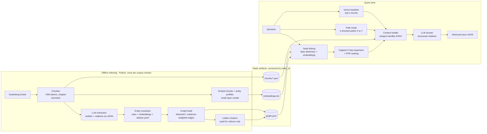
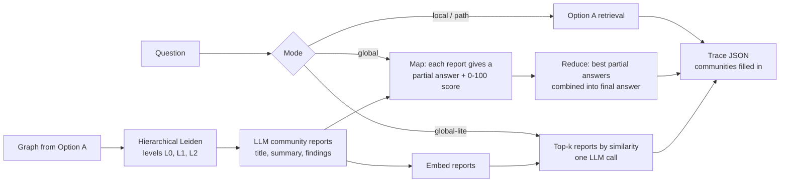
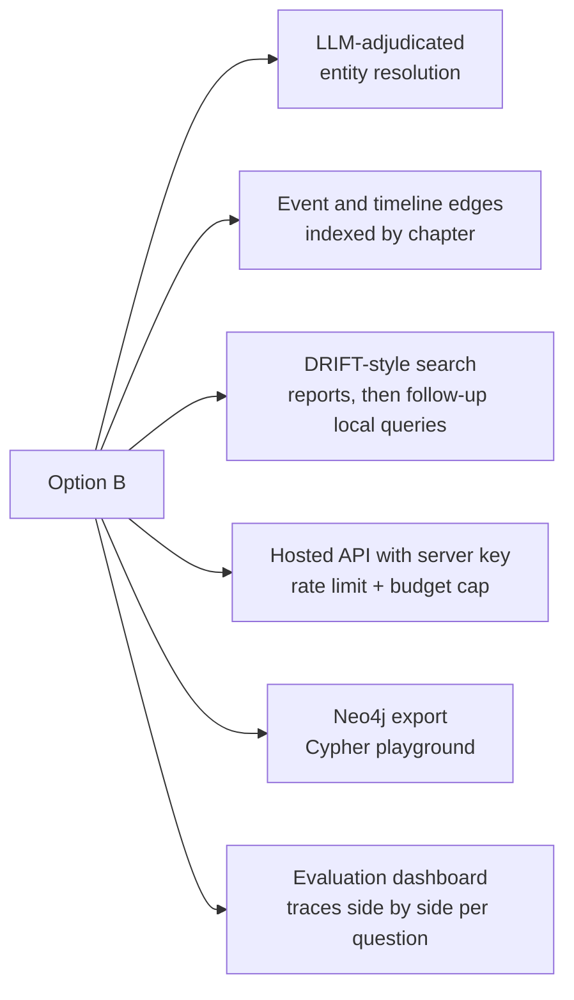
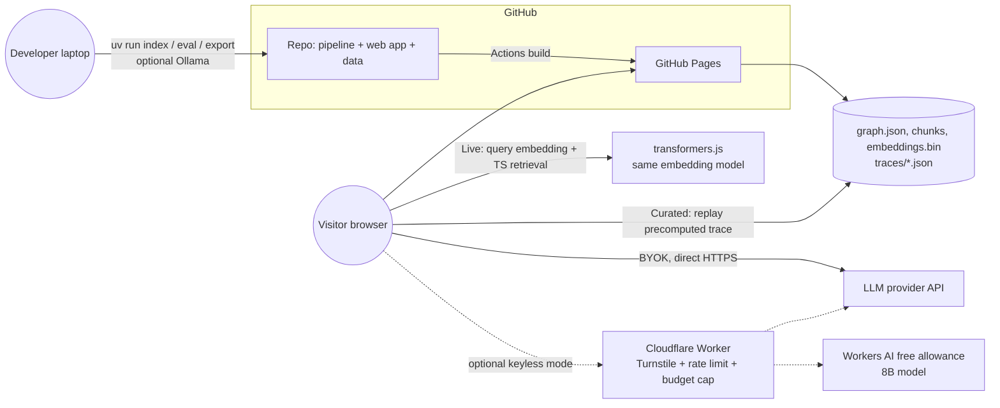

# 02 — Architecture discovery: Graph RAG over public-domain books

*Discovery document · 2026-10-05 · Scope: pipeline shape, data model, retrieval algorithms, the retrieval-trace contract, deployment topology, and cost. Library and visualization choices plus effort estimates are in the sibling survey.*

**How to read this.** A fact checked on 2026-10-05 carries a source tag like **[S6]** (the list is at the end). **(unverified)** means I could not confirm it from a primary source. Cost figures are estimates, and their assumptions are written next to them. Book examples use *The Hound of the Baskervilles* only to illustrate; the corpus is still undecided.

---

## TL;DR

- **Pipeline: hand-built and file-based.** Split each chapter into chunks of about 600 tokens. Make one LLM extraction call per chunk, with a **fixed list of entity types** (Character, Place, Group, Object) and **semi-open relations** (a free-text description plus one of ~10 standard relation types). Merge duplicate entities with name rules, embedding similarity and a hand-edited `aliases.yaml` file. Build the graph in NetworkX, with each edge weighted by the number of chunks that support it, then run Leiden clustering. Use a small open embedding model, the same one in Python and in the browser. The outputs are Parquet/JSON files plus one binary embedding matrix. There is no database server.
- **Retrieval: two graph modes plus two baselines.** Ship **Local** mode (find seed entities → expand up to 2 hops with a cap → rank with Personalized PageRank → collect the chunks that support the result). Ship **Path** mode ("how is X connected to Y", using k-shortest paths). Add a **plain vector-RAG baseline** and a **closed-book** baseline (no retrieval at all) for side-by-side comparison. Community summaries and **Global** map-reduce search come in v2 (Option B).
- **The trace contract is the product.** Every answer comes with one JSON *trace*. It lists the seeds, the nodes and edges (each with hop number and score), the communities, the chunks and the paths. Every element moves through three statuses: `candidate` (retrieved), then `context` (sent to the LLM), then `cited` (used in the answer). The LLM cites short handles like `[E2] [R5] [C3]` through structured output, and the code checks every citation. The UI only draws traces, so it cannot tell a precomputed answer from a live one.
- **Deployment: static first.** GitHub Pages hosts the precomputed graph plus about 25 curated query traces. That costs nothing, never goes to sleep and has nothing to abuse. A **live mode** runs retrieval in the browser, so the graph visualization works without any API key; answers are generated with the visitor's own key. A `uv run` local mode supports Ollama. As an optional add-on, a Cloudflare Worker proxy could provide answers without a visitor key, protected by Turnstile, a rate limit and a hard budget cap. Three hosting facts changed in 2026: Hugging Face made Gradio/Docker Spaces on free CPU a **PRO-only** feature ($9/mo) [S10][S11], **Fly.io has no free tier** [S15], and **GitHub Models was retired on 2026-07-30** [S22].
- **Cost.** One full indexing run over 1M words costs about **$1.5–10** with GPT-5-nano, Gemini 2.5 Flash-Lite, GPT-4o-mini or GPT-5-mini, and about **$21** with Claude Haiku 4.5. Batch APIs halve all of these. Budget **$10–30 in total**, including rounds of prompt tuning. A Local-mode query costs about **$0.001–0.004** (about $0.011 with Haiku 4.5). A map-reduce Global query costs roughly 10 times as much.

---

## 1. Architecture options (simplest → richest)

**What interviewers will probe.** (1) How you turn text into a graph: the extraction schema and entity resolution. (2) How the graph changes retrieval compared with vectors alone: seeding, expansion, ranking, paths, communities. (3) How you know it helps: evaluation against a baseline. (4) Cost and latency tradeoffs. Each option below is judged against these four.

### 1.0 Use a framework, or hand-build the pipeline?

| | Framework (Microsoft GraphRAG, LightRAG) | Hand-built minimal pipeline |
|---|---|---|
| Time to a first graph | Fastest | A few days slower |
| Trace detail | Whatever the framework's context builder exposes. GraphRAG local search returns tables of what it used, but not hop or score detail, and nothing about which elements were cited | Exactly what the UI needs |
| Interview story | "I configured X" | "I built entity resolution, PPR expansion and citation checking, and here is why each works that way" |
| Maintenance risk | Microsoft GraphRAG v3.2.0 (2026-09-23) is "largely in maintenance mode, and won't be accepting new PRs or implementing new features" [S24]. LightRAG is very active (~40k stars, several 2026 releases) [S31] | Your own ~1–2k lines |
| Cost control | Defaults include 1 gleaning pass (a second extraction pass over each chunk) and community reports at every level [S25] | You choose each stage |

**Recommendation: hand-build it.** Borrow ideas from Microsoft GraphRAG's prompts and defaults: 1,200-token chunks with 100 overlap, 1 gleaning pass, default entity types `organization, person, geo, event`, local search with a 12k-token budget that is 50% text, and community clusters of at most 10 entities [S25]. Optionally, run LightRAG once on the same corpus as an outside reference point in the evaluation.

### 1.1 Option A — Minimal Local Graph RAG (simplest; recommended MVP)



- **What it shows in an interview:** extraction schema design, entity resolution, graph traversal, Personalized PageRank ranking, path finding, citation-grounded answers, and an honest evaluation against vector RAG.
- **What it leaves out:** community summaries and "global sensemaking" questions. Communities exist only as node colours.
- **Cost:** about $1.5–10 to index 1M words; about $0.001–0.004 per query.
- **Complexity:** about 6 small Python modules (ingest, extract, resolve, build, embed, retrieve) plus one static web app.

### 1.2 Option B — A plus community reports and Global mode (target if time allows)



- **Adds:** hierarchical Leiden communities, each with an LLM-written *community report* (a title, a short summary and 3–5 findings about one cluster of entities). Also adds Global mode, Microsoft-style map-reduce over those reports, and a cheaper *global-lite* mode that picks the top-k reports by embedding similarity and makes a single LLM call.
- **What it shows:** the signature Microsoft GraphRAG idea, which is answering corpus-wide questions such as "What are the main factions across the books, and how do they relate?" [S28].
- **Extra cost:** about $0.3–2 more at indexing time. A Global query costs about $0.02–0.04 with GPT-5-mini and takes 10–60 s (estimate), so for the static demo, precompute the Global answers.
- **Complexity:** one more module and one more UI mode. The data model already has room for it (§5).

### 1.3 Option C — Rich (only if this becomes a long project)



- **Adds:** LLM adjudication of borderline entity merges; time-aware edges ("allies until chapter 12"); DRIFT search, Microsoft's hybrid that starts from community reports and then runs follow-up local searches [S30]; a hosted backend; a Neo4j export; and an evaluation dashboard.
- **Risk:** each addition is a new moving part and several days of work, and the "not overcomplicated" goal is lost.

| | A (MVP) | B (target) | C (rich) |
|---|---|---|---|
| Graph RAG concepts shown | Extraction, entity resolution, k-hop, PPR, paths, citations | + communities, map-reduce Global | + DRIFT, time, production hosting |
| Indexing LLM cost (1M words) | ≈ $1.5–9 | ≈ $1.8–10 | $10–40 (more passes) |
| Query modes | Local, Path, Vector, Closed-book | + Global, global-lite | + DRIFT |
| Runtime moving parts | Static site only | Static site only | Backend, proxy, optional database |
| Recommended? | **Build first** | **Plan the data model for it now** | Defer |

---

## 2. Indexing pipeline

| Stage | MVP? | What it buys | LLM cost | Notes |
|---|---|---|---|---|
| Ingest + clean (strip Gutenberg header/footer, split chapters) | Yes | Chapter metadata for citations and spoiler control | none | Chapter detection is per-book regex work |
| Chunking | Yes | The retrieval unit and the extraction unit | none | ~600 tokens, 100 overlap, never crossing a chapter |
| LLM entity + relation extraction | Yes | The graph itself | **~85% of indexing cost** | One call per chunk, JSON-schema output |
| Gleaning (a second "did you miss anything?" pass) | No | Better recall | Doubles extraction cost | GraphRAG default is 1 [S25]. Add only if recall is visibly poor |
| Entity resolution | **Yes** | Without it, "Holmes", "Mr. Holmes" and "Sherlock Holmes" become 3 nodes and traversal breaks | Small (optional LLM adjudication) | §2.4 |
| Merging relation and entity descriptions | Yes (cheap form) | Clean node and edge tooltips; better embeddings | Small | Summarize with an LLM only when an item has more than ~5 descriptions; otherwise concatenate |
| Graph build + metrics (degree, PageRank, first appearance) | Yes | Node sizing, hub handling, spoiler filter | none | |
| Community detection (Leiden) | Yes (as colours) | Visual clusters for free; the hook for Option B | none | NetworkX 3.7 has a native `leiden_communities` [S35] |
| Community reports | No → B | Global questions | Small (~$0.2–1) | |
| Embeddings | Yes | Seed linking, vector baseline, hybrid seeding | $0 with a local model | Same model at index time and in the browser |
| Claims/covariates (GraphRAG's optional fact extraction) | No | Fact-checking demos | Large | Skip |
| NLP-only extraction (GraphRAG's "FastGraphRAG": noun phrases from NLTK/spaCy, relations = co-occurrence in a chunk) | No | Near-zero extraction cost | Only summaries use the LLM | Much noisier graph and no typed relations [S27]. Worth one sentence in the README as the "cheap alternative I rejected" |

### 2.1 Chunking
- **Size.** Use ~600 tokens with ~100 overlap. The GraphRAG paper reports that 600-token chunks pulled out almost twice as many entity references as 2,400-token chunks [S28]. Their current default is 1,200/100 [S25]. Smaller chunks give better extraction recall and more precise citations, but make more LLM calls.
- **Boundaries.** Never cross a chapter. Encode the location in the chunk ID: `hound_ch06_c002`.
- **Scale.** For 1M words (≈1.33M tokens at ~0.75 words per token), the step between chunks is ~500 tokens, giving **≈2,700 chunks**. For 300k words, **≈800 chunks**.

### 2.2 Schema: fixed entity types, semi-open relations
- **Entity types (fixed):** `Character`, `Place`, `Group` (families, crews, institutions), `Object` (an artifact important to the plot). Fixed types drive UI colours and filters, and they block cross-type merges during entity resolution.
- **Skip `Event` nodes in the MVP.** Novels produce hundreds of one-off events, and they swamp the graph. Put the event in the relation's description instead ("Stapleton sets the hound on Sir Henry on the moor"). Revisit in Option C as time-indexed edges.
- **Relations: semi-open.** The LLM writes a free-text `description` and a `strength` from 1–10 (as in GraphRAG), and also picks one canonical `type` from a closed list of about 10. Suggested list: `FAMILY_OF, ALLY_OF, ENEMY_OF, ROMANTIC_WITH, SERVES, MEMBER_OF, LIVES_AT, LOCATED_IN, OWNS, INTERACTS_WITH` (the last is the fallback). The type powers legends and filters; the description keeps the nuance.
- **Fully open schemas** (any type, any predicate) look impressive at first. In practice they produce near-duplicate types ("Person" / "Human" / "Character") that you then have to normalize, which makes them more work, not less.

### 2.3 Extraction call
- **One call per chunk,** with a JSON-schema / structured output. Input is ≈1,500 tokens of instructions, schema and one short few-shot example, plus ≈600 tokens of chunk. Output is ≈600–1,000 tokens.
- **Ask for each entity:** `name` (the fullest name in the chunk), `surface_forms` (the exact strings used), `type` and a `description`.
- **Ask for each relation:** `source`, `target`, `type`, `description`, `strength`.
- **Optional dedup trick:** include a short *roster* in the prompt, meaning the top ~50 canonical names already extracted from that book, and ask the model to reuse those names. This sharply cuts duplicates. The cost is that calls within a book must run in order, which rules out a single batch job. A middle ground is a cheap pre-pass that builds the roster from book 1's chapter openings.
- **Static prefix is cached.** The same ~1.5k-token instruction prefix starts every call, so automatic prompt caching applies (GPT-5-mini cached input costs $0.025/M versus $0.25/M [S6]).

### 2.4 Entity resolution (dedup)
Run these steps in order. Each is cheap and easy to explain.
1. **Normalize names:** lowercase; strip honorifics (Mr, Mrs, Miss, Dr, Sir, Lady, Captain, …), possessives and punctuation.
2. **Block** candidate pairs so only entities of the same `type` and the same *series group* can merge. A series group is a set of books that share characters. This stops "John" in Book A from merging with an unrelated "John" in Book B.
3. **Exact match** on the normalized name → merge.
4. **Token-subset rule:** "Holmes" ⊂ "Sherlock Holmes". Merge only if exactly one full-name entity contains that token, or if one entity accounts for ≥90% of full-name mentions with that surname in the book. Otherwise leave the mention unresolved. This keeps "Mycroft Holmes" from being swallowed by Sherlock.
5. **Embedding similarity** of the *entity profile* (the text `name + type + description`) above a tuned threshold (start around 0.88) produces **candidate** pairs. In the MVP, list them for review. In Option C, an LLM adjudicates them in a single batch.
6. **`aliases.yaml` override file:** hand-written merges and splits, applied last. This is legitimate engineering, not cheating. Show it in the repo and the README.
7. **Record every merge** in `aliases` so the UI can say "also known as: Holmes, Mr. Holmes, Sherlock". That makes the resolution step visible to the viewer.

Pronouns ("he") are not resolved. The extraction LLM reads them in context, which is good enough for chunk-level extraction.

### 2.5 Graph construction
- **One edge per (source, target, type).** Every extraction of the same relation becomes an evidence row: `{chunk_id, description, strength}`.
- **Weight** = the number of distinct supporting chunks, optionally scaled by mean strength. Weight drives edge thickness, ranking and path cost.
- **Store edges directed** (for semantics), but traverse them as undirected.
- **Optional co-occurrence layer:** a low-weight `CO_OCCURS` edge between entities that appear in the same chunk. It raises recall for relations the LLM missed but adds noise. Keep it hidden by default.
- **Expected size,** taken from the GraphRAG paper's ~1M-token podcast corpus: **8,564 entities and 20,691 relationships** [S28]. Expect a few thousand entities after dedup and 10–25k edges. That is tiny for in-memory graph tools.

### 2.6 Community detection and summaries
- **MVP:** run single-level Leiden (or Louvain) once with a fixed `seed` so results are reproducible. Store `community_id` on each node for colouring. It costs nothing.
- **Option B:** make it hierarchical by running Leiden again inside any cluster larger than N. GraphRAG uses `max_cluster_size = 10` [S25]. Then generate one report per community, giving the LLM member entities, top edges and a few evidence snippets (the report limit in GraphRAG is 2,000 tokens [S25]).

### 2.7 Embeddings
- **What to embed:** (1) chunks, for the vector baseline and hybrid seeding; (2) entity profiles, for seed linking; (3) optionally relation descriptions, for query-aware edge ranking; (4) community reports (Option B).
- **Model constraint:** if live retrieval runs in the browser (§6), the *query* must be embedded in the browser with **the same model used at index time**. That rules out API-only embedding models unless you run a backend. Use a small open model available both in Python (sentence-transformers) and as ONNX for transformers.js v4 (stable since February 2026, with a WebGPU runtime [S36]).
- **Model options:** a ~384-dimension "small" English model (bge-small or MiniLM class, roughly a 20–35 MB quantized download — **unverified exact sizes**), or **EmbeddingGemma-300m** (768 dimensions, can be cut to 512/256/128; 168 MB at q4f16 or 295 MB at q8 in the browser [S37]). For a fast first page load, prefer the small model.

---

## 3. Retrieval modes

**Terms used in this section.**
- **Seed:** an entity that the question is linked to directly.
- **Hop:** the graph distance from the nearest seed. Seeds are hop 0.
- **PPR (Personalized PageRank):** a random walk that keeps jumping back to the seeds. Nodes it visits often are "relevant to these seeds". HippoRAG popularized PPR for graph retrieval [S34].

### 3.1 Local (entity-centric) — **ship it**
1. **Seed linking.** Take the union of three signals:
   - (a) **Alias dictionary:** match n-grams of the question against all aliases (exact, then fuzzy). This is deterministic, fast, and ideal for named characters and places.
   - (b) **Embedding similarity:** compare the question with entity profiles and take the top-k (k≈5) above a threshold.
   - (c) **Fallback when nothing matches** ("Who betrayed the captain?"): embed the question, take the top vector chunks, and use the entities those chunks mention as seeds. This is the *hybrid* path from §3.3.
2. **Capped expansion.** Breadth-first search to 2 hops. At each node, keep only the top-m neighbours (m≈8), ranked by edge weight × similarity between the edge description and the question. Without this cap, the main protagonist connects to everything and 2 hops cover half the graph.
3. **Ranking.** Run PPR personalized on the seeds over the candidate subgraph. Divide by `degree^β` (β≈0.5) so hubs don't win by default. Keep the top-N nodes (N≈30) and the top-M edges among them (M≈40).
4. **Chunks.** Collect (i) the evidence chunks of the kept edges and (ii) the chunks that mention seeds. Score each as `0.5·cosine(question, chunk) + 0.5·(number of kept entities it mentions, normalized)`. Keep the top 8.
5. **Context assembly.** Entity profiles, relation descriptions and chunks, each with a handle (§4.3), filled up to a token budget (8–12k). Record everything that was dropped as `candidate`.

- **Strengths:** precise, cheap (one LLM call), and highly visual. It answers multi-hop questions such as "Who employs the man who rescued X?".
- **Failure modes:** questions with no clear entity (handled by the hybrid fallback); entity-resolution mistakes, which cascade; and extraction recall. One study found only ~65% of answer entities present in LLM-built knowledge graphs on HotpotQA and NQ [S32]. That is why chunks always stay in the context.

### 3.2 Global (community-summary map-reduce, Microsoft GraphRAG style) — **Option B**
GraphRAG ships four query modes: global, local, DRIFT and basic (plain vector) [S26]. This section describes the global one.
- **Map:** each community report at the chosen level gets the question and returns a partial answer with a helpfulness score from 0–100. Partial answers scoring 0 are dropped. GraphRAG caps each map answer at 1,000 tokens and the reduce answer at 2,000 [S25].
- **Reduce:** sort the partial answers by score, fill the context budget, and write the final answer.
- **Strength:** corpus-wide "sensemaking" questions. The paper reports 72–83% win rates on comprehensiveness against vector RAG [S28].
- **Cost:** one LLM call per community per query, which is roughly 10 times a Local query in money and 10–60 s of latency.
- **Cheaper variants:** *global-lite* (top-k reports by embedding similarity, one call). Microsoft's LazyGraphRAG defers summarization to query time and claims indexing cost of 0.1% of full GraphRAG [S29]; whether it is available open-source today is **unverified**, since GraphRAG is in maintenance mode [S24].

### 3.3 Hybrid (vector chunks + graph neighbourhood)
- **How it works:** take the top-k chunks by vector search, use the entities in those chunks as seeds, expand 1 hop, and merge the graph context with the chunks.
- **Evidence for it:** the "RAG vs. GraphRAG" study found that **combining** both kinds of retrieval was consistently better than either alone. Routing each question to one method was cheaper but less accurate [S32].
- **Recommendation:** build it as the Local mode's seeding fallback rather than as a separate UI mode. That gets most of the benefit with no new surface.

### 3.4 Path ("how is X connected to Y") — **ship it**
1. Link X and Y with the same seed linking as Local mode.
2. Search for paths of at most 4 hops with `nx.shortest_simple_paths`, which uses Yen's algorithm to yield paths in order of increasing cost. Use edge `cost = 1/(1+log(1+weight)) + α·log(1+degree(intermediate node))`. The degree term stops every path from routing through the protagonist.
3. Keep the top 3 paths. Attach 1–2 evidence chunks to each edge. The LLM then narrates the chain and cites every edge.

- **Why ship it:** it costs no LLM money to find the paths, the visualization is striking, and it shows something vector RAG fundamentally cannot do. That is the clearest "why a graph?" moment for an interviewer.

### 3.5 Comparison

| Mode | Question type | LLM calls/query | Cost/query (GPT-5-mini) | Latency | Needs | Visual payoff |
|---|---|---|---|---|---|---|
| Local (+hybrid seeding) | Specific, multi-hop, entity-named | 1 | ≈$0.0035 | 2–6 s | Graph + embeddings | High (expanding subgraph) |
| Path | "How are X and Y connected?" | 1 (narration) | ≈$0.003 | 2–5 s | Graph | Very high (highlighted chains) |
| Global map-reduce | Thematic, whole-corpus | ~#communities + 1 | ≈$0.04 | 10–60 s | Community reports | Medium (communities light up) |
| Global-lite | Thematic, approximate | 1 | ≈$0.003 | 2–6 s | Community reports + embeddings | Medium |
| Vector baseline | Single-hop facts | 1 | ≈$0.003 | 2–5 s | Chunk embeddings | Low (overlay its chunks' entities on the graph) |
| Closed-book | What the model already knows | 1 | ≈$0.001 | 1–3 s | Nothing | None (control condition) |

### 3.6 Recommendation
- **MVP ships Local (with hybrid seeding) and Path.** Add the vector and closed-book baselines, which are almost free to add once the context builder exists.
- **Option B adds global-lite first,** then full map-reduce Global, precomputed for the static demo.

### 3.7 Baselines for side-by-side
- **Vector RAG:** embed the question, take the top-k chunks (k chosen so the context size roughly matches Local's), and use the same LLM, prompt and citation format. Show it side by side.
- **Overlay trick:** highlight on the graph the entities that the vector baseline's chunks happen to mention. Viewers see how scattered pure vector retrieval is compared with the connected subgraph from Local.
- **Closed-book:** the same LLM with no context. **This matters a lot for famous public-domain books.** The LLM has almost certainly read Sherlock Holmes, so correct answers prove little. The closed-book score measures how much retrieval actually adds. Weighting the evaluation toward *grounded* metrics (citations, retrieval recall) counters this.

### 3.8 Evaluation: Graph RAG vs. baseline on a small hand-written set

**Question set (30–50 questions, written by hand before tuning).** Use 5 categories of 6–10 questions each, so you can report per-category results.

| Category | Example (Hound of the Baskervilles) | Expected winner |
|---|---|---|
| Single-hop fact | "What is Dr. Mortimer's profession?" | Tie, or vector wins [S32][S33] |
| Multi-hop relational | "Who is the butler's wife's brother, and why is he on the moor?" | Graph |
| Connection / path | "How is Stapleton connected to the Baskerville family?" | Graph (Path) |
| Cross-book aggregation | "In which books does Lestrade appear, and in what role?" | Graph |
| Global / thematic | "What groups of characters drive the conflict, and how do they relate?" | Graph Global (Option B) |

**For each question, record:** a short gold answer, the gold entities, and the gold evidence (chapter numbers are enough; chunk IDs if you have them).

**Metrics, cheapest and most trustworthy first.**
1. **Retrieval recall** (deterministic, no LLM): the share of gold entities and gold chapters present in the `context` set. This compares *retrieval* directly and does not depend on generation.
2. **Answer correctness** against the gold answer: correct / partial / wrong. With 30–50 questions, **grade by hand** and also run an LLM judge (reference-based, using a different model family from the generator). Report how often the two agree. If agreement is high, the LLM judge can be trusted for re-runs.
3. **Citation precision:** the share of cited chunks that really support their sentence. Check by hand on a sample, or with an LLM judge.
4. **Cost, latency and context tokens** per query. These come free from the trace's `metrics`.
5. **Global questions only:** pairwise LLM judging on comprehensiveness and diversity, as in the GraphRAG paper [S28]. Judge **both orderings** of each pair and count a win only when the two agree. Position bias in LLM judges is well documented, and in RAG-vs-GraphRAG comparisons reversing the order sometimes flipped the verdict [S32][S48].

**Expected result, worth reporting honestly:** vector ≈ graph on single-hop questions, and graph ahead on multi-hop, path and global questions. That nuance is itself a strong interview talking point. Benchmarks report the same pattern, including on a novel-based dataset [S33].

**Evaluation cost:** 50 questions × 4 systems × (one answer + one judge call) is under $2 per full run with GPT-5-mini (estimate, §7). No framework is needed; RAGAS is optional.

---

## 4. The retrieval trace contract

### 4.1 Principles
1. **One trace per answer, for every mode.** The Vector, Closed-book, Local, Path and Global modes all emit the same shape; the arrays that don't apply are empty. The UI has a single renderer.
2. **The trace refers to the graph; the artifact defines it.** A trace holds IDs plus per-query data (hop, score, status). Static attributes such as names, descriptions and chunk text come from the graph artifact the UI has already loaded. This keeps traces to a few KB, so precomputed traces are cheap to ship. A `label` is copied in only for readability.
3. **Every trace pins an `index_id`,** a hash of the artifacts. After re-indexing, stale precomputed traces are detected rather than silently showing the wrong nodes.
4. **`answer` can be `null`.** Retrieval-only mode, with no LLM key, still yields a complete, renderable trace. That is what makes free live mode possible (§6).

### 4.2 The status ladder
Every node, edge, path, community and chunk has exactly one `status`:

| Status | Meaning | Suggested UI |
|---|---|---|
| `candidate` | Reached during seeding or expansion, but dropped before the context was built (cap, budget, low score) | Faded or outlined |
| `context` | Sent to the LLM in the prompt | Normal colour |
| `cited` | Referenced by at least one *valid* citation in the answer | Highlighted / glowing |

The sets nest: cited ⊂ context ⊂ candidate. A `cited` chunk also implies its entities light up.

The UI can replay the retrieval in steps: seeds (hop 0) → hop 1 → hop 2 → which elements were pruned → context → cited. All of it comes from `hop` and `status`, so no separate event log is needed.

### 4.3 How the LLM cites (so the UI knows "used" from "merely retrieved")
- **Short handles in the prompt.** The context builder gives each context element a short *handle*, a prompt-local label: `E1…` for entities, `R1…` for relations, `C1…` for chunks, `K1…` for communities. Example:

  ```text
  ## Entities
  [E1] Sherlock Holmes (Character): consulting detective in London ...
  ## Relationships
  [R1] Sherlock Holmes -> John Watson (ALLY_OF): Holmes sends Watson to Devonshire ...
  ## Passages
  [C1] (The Hound of the Baskervilles, ch. 5) <chunk text>
  ```

- **Structured output, sentence by sentence.** The model must return:
  `{"sentences":[{"text":"...","cites":["C1","R1"]}], "insufficient_context": false}`.
  Sentence-level citations let the UI underline each sentence and light up exactly what it relied on.
- **Code-side checks.** Map handles back to stable IDs through the context's `handles` table. Handles that were never in the context go into `invalid_handles`, which counts as a hallucinated-citation metric. Sentences with no citation go into `uncited_sentence_idx` (shown with a dotted underline).
- **Promotion rule (deterministic).** An element becomes `cited` if (i) a valid handle references it, (ii) it is an endpoint of a cited edge, or (iii) it is on a cited path. A further rule — promoting entities that are merely *mentioned* in a cited chunk — is left as open decision #11.
- **Why handles instead of raw IDs:** fewer tokens, almost no ID hallucination, and validation is trivial.
- **Streaming tradeoff.** Structured output arrives whole, not word by word. If you want streaming, ask for inline markers ("…to Devonshire [R1][C2].") and parse them with a regex. That gives the same validation but is less robust to formatting drift. Recommendation: structured output for the MVP.
- **Provider-native citations exist** (for example, Anthropic's citations on document blocks), but they tie you to one provider. The handle scheme is portable.

### 4.4 Schema
Written in TypeScript notation. It converts mechanically to JSON Schema or Pydantic; generate both from one source.

```ts
type Status = "candidate" | "context" | "cited";
type Mode = "local" | "path" | "global" | "global_lite" | "vector" | "closed_book";

interface RetrievalTrace {
  trace_version: "1.0";
  trace_id: string;
  index_id: string;                 // hash of graph/chunk/embedding artifacts used
  created_at: string;               // ISO-8601
  source: "live" | "precomputed";
  query: {
    text: string;
    mode: Mode;
    params: Record<string, number | string>;   // k_seeds, max_hops, top_m, token_budget, embed_model, llm ...
  };
  seeds: Seed[];
  nodes: TraceNode[];
  edges: TraceEdge[];
  paths: TracePath[];               // path mode only, else []
  communities: TraceCommunity[];    // Option B, else []
  chunks: TraceChunk[];
  context: {
    handles: Record<string, string>;  // "E1" -> "ent_sherlock_holmes"
    token_count: number;
    token_budget: number;
    truncated: boolean;
  };
  answer: Answer | null;            // null = retrieval-only (no LLM key)
  metrics: {
    timings_ms: Record<string, number>;          // seed, expand, rank, assemble, generate
    usage?: { model: string; input_tokens: number; output_tokens: number; cost_usd: number };
  };
}

interface Seed {
  node_id: string;
  method: "alias_exact" | "alias_fuzzy" | "embedding" | "vector_chunk";
  matched_text?: string;            // span of the question that matched
  score: number;                    // 0..1
}

interface TraceNode {
  id: string; label?: string;
  hop: number;                      // 0 = seed
  score: number;                    // mode-specific, normalised 0..1 (PPR for local)
  status: Status;
  handle?: string;                  // present iff status != "candidate"
  reached_via?: string;             // edge id that first reached it (absent for seeds)
  pruned_reason?: "neighbour_cap" | "rank_cutoff" | "token_budget";
}

interface TraceEdge {
  id: string; source: string; target: string; type: string;
  hop: number;                      // max(hop(source), hop(target))
  score: number; status: Status; handle?: string;
  evidence_chunk_ids: string[];     // subset of the edge's evidence that is in `chunks`
  pruned_reason?: "neighbour_cap" | "rank_cutoff" | "token_budget";
}

interface TracePath {
  rank: number; cost: number; status: Status;
  node_ids: string[]; edge_ids: string[];
}

interface TraceCommunity {
  id: string; level: number; score: number; status: Status; handle?: string;
  method: "contains_seed" | "summary_embedding" | "map_reduce";
  map_helpfulness?: number;         // 0..100, global map step
}

interface TraceChunk {
  id: string; rank: number; score: number; status: Status; handle?: string;
  retrieved_by: string[];           // "vector", "evidence:rel_0193", "mentions:ent_john_watson"
  highlight_entity_ids: string[];   // entities whose mentions to highlight in the passage
}

interface Answer {
  text: string;
  sentences: { text: string; cites: string[] }[];   // cites = resolved element ids
  invalid_handles: string[];
  uncited_sentence_idx: number[];
  insufficient_context: boolean;
}
```

### 4.5 Realistic example (Local mode; IDs, scores and timings are illustrative)

```json
{
  "trace_version": "1.0",
  "trace_id": "tr_01JA7Q2W9H",
  "index_id": "idx_7f3c2a",
  "created_at": "2026-10-05T14:12:03Z",
  "source": "precomputed",
  "query": {
    "text": "Why does Holmes send Watson to Baskerville Hall?",
    "mode": "local",
    "params": { "k_seeds": 5, "max_hops": 2, "top_m": 8, "top_nodes": 30, "top_chunks": 8,
                "token_budget": 10000, "embed_model": "small-en-384", "llm": "gpt-5-mini" }
  },
  "seeds": [
    { "node_id": "ent_sherlock_holmes", "method": "alias_exact", "matched_text": "Holmes", "score": 1.0 },
    { "node_id": "ent_john_watson", "method": "alias_exact", "matched_text": "Watson", "score": 1.0 },
    { "node_id": "ent_baskerville_hall", "method": "alias_exact", "matched_text": "Baskerville Hall", "score": 1.0 }
  ],
  "nodes": [
    { "id": "ent_sherlock_holmes", "label": "Sherlock Holmes", "hop": 0, "score": 1.00, "status": "cited", "handle": "E1" },
    { "id": "ent_john_watson", "label": "Dr. John Watson", "hop": 0, "score": 0.94, "status": "cited", "handle": "E2" },
    { "id": "ent_baskerville_hall", "label": "Baskerville Hall", "hop": 0, "score": 0.71, "status": "cited", "handle": "E3" },
    { "id": "ent_henry_baskerville", "label": "Sir Henry Baskerville", "hop": 1, "score": 0.83, "status": "cited", "handle": "E4", "reached_via": "rel_0412" },
    { "id": "ent_james_mortimer", "label": "Dr. James Mortimer", "hop": 1, "score": 0.52, "status": "context", "handle": "E5", "reached_via": "rel_0388" },
    { "id": "ent_charles_baskerville", "label": "Sir Charles Baskerville", "hop": 2, "score": 0.47, "status": "cited", "handle": "E6", "reached_via": "rel_0431" },
    { "id": "ent_stapleton", "label": "Stapleton", "hop": 2, "score": 0.21, "status": "candidate", "reached_via": "rel_0501", "pruned_reason": "rank_cutoff" },
    { "id": "ent_barrymore", "label": "Barrymore", "hop": 1, "score": 0.18, "status": "candidate", "reached_via": "rel_0477", "pruned_reason": "rank_cutoff" }
  ],
  "edges": [
    { "id": "rel_0193", "source": "ent_sherlock_holmes", "target": "ent_john_watson", "type": "ALLY_OF",
      "hop": 0, "score": 0.91, "status": "cited", "handle": "R1", "evidence_chunk_ids": ["hound_ch05_c006", "hound_ch06_c001"] },
    { "id": "rel_0412", "source": "ent_john_watson", "target": "ent_henry_baskerville", "type": "ALLY_OF",
      "hop": 1, "score": 0.86, "status": "cited", "handle": "R2", "evidence_chunk_ids": ["hound_ch06_c001"] },
    { "id": "rel_0450", "source": "ent_henry_baskerville", "target": "ent_baskerville_hall", "type": "OWNS",
      "hop": 1, "score": 0.64, "status": "cited", "handle": "R3", "evidence_chunk_ids": ["hound_ch02_c009"] },
    { "id": "rel_0431", "source": "ent_henry_baskerville", "target": "ent_charles_baskerville", "type": "FAMILY_OF",
      "hop": 2, "score": 0.58, "status": "cited", "handle": "R5", "evidence_chunk_ids": ["hound_ch02_c009"] },
    { "id": "rel_0388", "source": "ent_james_mortimer", "target": "ent_sherlock_holmes", "type": "INTERACTS_WITH",
      "hop": 1, "score": 0.49, "status": "context", "handle": "R4", "evidence_chunk_ids": ["hound_ch02_c001"] },
    { "id": "rel_0501", "source": "ent_stapleton", "target": "ent_henry_baskerville", "type": "ENEMY_OF",
      "hop": 2, "score": 0.20, "status": "candidate", "evidence_chunk_ids": [], "pruned_reason": "rank_cutoff" },
    { "id": "rel_0477", "source": "ent_barrymore", "target": "ent_baskerville_hall", "type": "SERVES",
      "hop": 1, "score": 0.17, "status": "candidate", "evidence_chunk_ids": [], "pruned_reason": "rank_cutoff" }
  ],
  "paths": [],
  "communities": [
    { "id": "comm_L0_03", "level": 0, "score": 0.58, "status": "context", "handle": "K1", "method": "contains_seed" }
  ],
  "chunks": [
    { "id": "hound_ch05_c006", "rank": 1, "score": 0.81, "status": "cited", "handle": "C1",
      "retrieved_by": ["vector", "evidence:rel_0193"], "highlight_entity_ids": ["ent_sherlock_holmes", "ent_john_watson"] },
    { "id": "hound_ch06_c001", "rank": 2, "score": 0.78, "status": "cited", "handle": "C2",
      "retrieved_by": ["evidence:rel_0193", "evidence:rel_0412"], "highlight_entity_ids": ["ent_sherlock_holmes", "ent_john_watson", "ent_henry_baskerville"] },
    { "id": "hound_ch02_c009", "rank": 3, "score": 0.55, "status": "cited", "handle": "C3",
      "retrieved_by": ["evidence:rel_0450"], "highlight_entity_ids": ["ent_henry_baskerville", "ent_charles_baskerville"] },
    { "id": "hound_ch02_c001", "rank": 4, "score": 0.44, "status": "context", "handle": "C4",
      "retrieved_by": ["evidence:rel_0388"], "highlight_entity_ids": ["ent_james_mortimer"] },
    { "id": "hound_ch14_c003", "rank": 9, "score": 0.31, "status": "candidate",
      "retrieved_by": ["vector"], "highlight_entity_ids": ["ent_stapleton"] }
  ],
  "context": {
    "handles": { "E1": "ent_sherlock_holmes", "E2": "ent_john_watson", "E3": "ent_baskerville_hall",
                 "E4": "ent_henry_baskerville", "E5": "ent_james_mortimer", "E6": "ent_charles_baskerville",
                 "R1": "rel_0193", "R2": "rel_0412", "R3": "rel_0450", "R4": "rel_0388", "R5": "rel_0431",
                 "K1": "comm_L0_03", "C1": "hound_ch05_c006", "C2": "hound_ch06_c001",
                 "C3": "hound_ch02_c009", "C4": "hound_ch02_c001" },
    "token_count": 7420,
    "token_budget": 10000,
    "truncated": false
  },
  "answer": {
    "text": "Holmes says he cannot leave London because another pressing case keeps him there. He therefore sends Watson to accompany Sir Henry Baskerville to Devonshire, watch over him, and report the facts back by letter. Sir Henry has just inherited Baskerville Hall after the death of his uncle, Sir Charles.",
    "sentences": [
      { "text": "Holmes says he cannot leave London because another pressing case keeps him there.",
        "cites": ["hound_ch05_c006"] },
      { "text": "He therefore sends Watson to accompany Sir Henry Baskerville to Devonshire, watch over him, and report the facts back by letter.",
        "cites": ["rel_0193", "rel_0412", "hound_ch06_c001"] },
      { "text": "Sir Henry has just inherited Baskerville Hall after the death of his uncle, Sir Charles.",
        "cites": ["rel_0450", "rel_0431", "hound_ch02_c009"] }
    ],
    "invalid_handles": [],
    "uncited_sentence_idx": [],
    "insufficient_context": false
  },
  "metrics": {
    "timings_ms": { "seed": 6, "expand": 4, "rank": 11, "assemble": 3, "generate": 2380 },
    "usage": { "model": "gpt-5-mini", "input_tokens": 8150, "output_tokens": 410, "cost_usd": 0.0029 }
  }
}
```

**In this example, the UI would show:**
- The four cited edges glowing: Holmes→Watson, Watson→Sir Henry, Sir Henry→Baskerville Hall and Sir Henry→Sir Charles.
- Their endpoints (Holmes, Watson, Sir Henry, Baskerville Hall, Sir Charles) also glowing, under promotion rule (ii).
- Mortimer drawn normally: his entity, relation and passage were in the context but never cited.
- Stapleton and Barrymore faded: retrieved but pruned. Hovering shows "rank_cutoff".
- Three cited passages, with names highlighted and each answer sentence linked to its evidence. The ch. 14 chunk is listed as a pruned candidate.

### 4.6 Per-mode notes
- **Path mode:** fills `paths`. Every node and edge on a kept path is at least `context`. `hop` is the position along the path.
- **Global modes:** fill `communities` with `map_helpfulness`. Nodes are the members of the cited communities, at status `context`, with `hop` = −1 (not applicable).
- **Vector mode:** only `chunks` is filled. The UI can still overlay `highlight_entity_ids` on the graph (the trick from §3.7).
- **Closed-book:** every array is empty except `answer`. Its sentences have empty `cites`, which makes the "no evidence" message obvious to the viewer.

---

## 5. Data model and storage

### 5.1 Schemas (canonical tables; Parquet on disk)

**Book:** `id, title, author, gutenberg_id, year, series_group, chapters[{n, title}]`.

**Chunk:** `id ("{book}_ch{NN}_c{NNN}"), book_id, chapter, ordinal, text, token_count, char_start, char_end, entity_ids[]`.

**Entity:**

| Field | Type | Why it exists |
|---|---|---|
| `id` | `ent_` + slug of the canonical name | Stable across re-runs as long as the canonical name doesn't change |
| `name`, `type` | str, enum | Display, colour, merge blocking |
| `aliases` | list[str] | Lets the UI explain merges; also the alias dictionary for seed linking |
| `description` | str | Merged profile; this is what gets embedded |
| `book_ids`, `first_seen{book_id, chapter}` | | Cross-book questions; optional spoiler filter |
| `mention_count`, `degree`, `pagerank` | | Node size; hub damping |
| `community_ids` | list[str] (one per level) | Colours (A) and reports (B) |

**Mention:** `entity_id, chunk_id, surface_form, char_start?, char_end?`. Offsets are found by string search after extraction and left null if not found. This table is what lets the UI highlight names inside passages.

**Relation:** `id (rel_ + hash(source, target, type)), source, target, type, description, weight, evidence[{chunk_id, description, strength}], book_ids, first_seen`.

**Community (Option B fields nullable in A):** `id ("comm_L{level}_{n}"), level, parent_id, entity_ids[], size, title?, summary?, findings[]?, rank?`.

**Layout on disk.**
- **Build output:** `data/index/{index_id}/{books,chunks,entities,mentions,relations,communities}.parquet` plus `embeddings/{chunks,entities}.npy`.
- **Web export:** `site/data/graph.json` (entities + relations, without evidence text), `site/data/chunks/{book}.json`, `site/data/embeddings.f16.bin` (plus a JSON row index), and `site/traces/*.json`.

### 5.2 Graph storage options

| Option | Fits this size? | Moving parts | Query capability | Reusable in browser? | Status (Oct 2026) | Verdict |
|---|---|---|---|---|---|---|
| **NetworkX + Parquet/JSON** | Yes; about 10⁴ nodes and a few times 10⁴ edges is trivial in memory | None | BFS, PageRank with personalization, Yen's k-shortest paths, native Leiden [S35] | The JSON export *is* the browser data | NetworkX 3.7 stable docs [S35] | **Pick** |
| SQLite / DuckDB tables | Yes | One file | SQL, recursive CTEs for hops. DuckPGQ adds SQL/PGQ graph queries but is a community extension "still under active development", with crash reports in April 2026 [S44] | Possible via WASM builds, but heavier | Mature (the core engines) | Fine if you want SQL on your CV; not needed |
| Embedded graph DB (Kùzu → forks) | Yes | None (in-process), but a young engine | Cypher, vector search, full-text search | Kùzu had a WASM build (**unverified** for the forks) | **Kùzu archived on 2025-10-10 at v0.11.3** ("Kuzu is working on something new!") [S1][S2][S3]. Successor **LadybugDB** (`pip install ladybug`) is active: v0.19.1 in Aug 2026, dev builds in Sept 2026 [S3][S4]. The Vela Partners fork released 0.12.0 in May 2026 [S5]. Reports that an acquisition caused the archive are **unverified** | Avoid for the MVP: format and API churn, and nothing gained at this size |
| Neo4j local (Docker) | Yes | 1 container | Cypher, the GDS library (Leiden, PPR) | No | Mature | Optional **export** script only (`neo4j-admin import` CSVs). Good as a CV keyword, but not on the runtime path |
| Neo4j AuraDB Free | Yes (200k nodes / 400k relationships) | Managed service | Cypher | No | Pauses after **3 days without writes**; a paused free instance is **deleted after 30 days** (from a search summary of Neo4j's FAQ) [S45] | Bad for a demo that must be up whenever a recruiter clicks |

### 5.3 Vector storage options

| Option | Notes | Verdict |
|---|---|---|
| **In-memory numpy (brute-force cosine)** | ≈3k chunk vectors + a few thousand entity vectors at 384 dimensions. One full scan is a few million multiply-adds, which is milliseconds (estimate). The same 10 lines port to TypeScript over a `Float32Array` | **Pick** |
| FAISS | An index you don't need below about 10⁵ vectors | Skip |
| LanceDB | Embedded, Arrow-native; v0.39.0 in Sept 2026 [S42] | Good later; not needed |
| Chroma | 1.5.x releases through 2026 [S43] | Not needed |
| sqlite-vec | v0.1.9 in March 2026, 0.1.10 alpha in May 2026; one maintainer plus a community fork [S41] | Use only if you pick SQLite for the graph |

### 5.4 Size budget (1M words, estimates)
- **Chunk text:** about 6 MB raw (about 2–3 MB gzipped).
- **Graph JSON** with descriptions: about 3–7 MB raw.
- **Entity embeddings:** about 5k × 384 dimensions × float16 ≈ 4 MB. **Chunk embeddings:** about 2.7k × 384 × float16 ≈ 2 MB.
- **Traces:** a few KB each.

**Total:** roughly 10–20 MB, well inside GitHub Pages' 1 GB site limit [S21]. To shrink it, load chunk text per book on demand and leave entities with only one mention out of the browser bundle.

---

## 6. Deployment topology ("try it on GitHub")

### 6.1 Verified hosting facts (checked 2026-10-05)

| Platform | Free terms that matter here | Source |
|---|---|---|
| GitHub Pages | Free static hosting; 1 GB site; 100 GB/month soft bandwidth limit; 10 builds/hour soft limit (Actions-based deploys avoid it). Not allowed as free hosting for commercial SaaS, and sites "shouldn't be used for sensitive transactions like sending passwords or credit card numbers" (see the BYOK note in §6.5) | [S21] |
| GitHub Models | **Retired on 2026-07-30.** It can't be used as a free LLM backend | [S22] |
| GitHub Codespaces | 120 core-hours/month included for personal accounts (about 60 h on 2 cores), paid by the *visitor's* quota (from a search summary) | [S23] |
| Hugging Face Spaces | **Static Spaces are free. Gradio and Docker Spaces now need a paid plan (PRO $9/mo) to create, even on free CPU Basic.** Free personal accounts may host up to 2 Gradio Spaces on ZeroGPU (daily quota). CPU Basic is 2 vCPU / 16 GB and sleeps when unused | [S10][S11][S12] |
| Streamlit Community Cloud | Free; app must come from a GitHub repo; sleeps after 12 h with no traffic and a viewer must click to wake it; 0.078–2 cores, 690 MB–2.7 GB RAM (limits as of Feb 2024 in the docs) | [S13] |
| Render (free web service) | Spins down after 15 min idle; about 1 min cold start; 750 free instance-hours/month per workspace | [S14] |
| Fly.io | **No free tier** for new organizations; trial of 2 machine-hours or 7 days; smallest always-on app costs $2.19 per 30 days | [S15] |
| Vercel Hobby | Free, non-commercial; functions up to 300 s; 1M invocations/month; Python bundles up to 500 MB (from search summaries of Vercel docs) | [S16] |
| Cloudflare Workers (free) | 100k requests/day; 10 ms CPU per invocation (fine for proxying, since waiting on a fetch is not CPU time); a rate-limiting binding (10 s or 60 s windows, "permissive, eventually consistent"; whether it is on the free plan is **unverified**) | [S17][S19] |
| Cloudflare Workers AI | **10,000 Neurons/day free.** Llama 3.1 8B Instruct FP8 costs $0.152/M input and $0.287/M output | [S18] |
| Cloudflare Turnstile | Free bot challenge, up to 20 widgets (third-party summary) | [S20] |

### 6.2 Options compared

| | Visitor experience | Cost to you | API-key abuse risk | Complexity |
|---|---|---|---|---|
| **(a) Fully static, precomputed** (Pages: graph + curated traces) | Instant, never sleeps. Graph browsing is fully free-form; questions are limited to the curated list (~25), so a skeptic may suspect cherry-picking | $0 | None | **Lowest** |
| **(b) Static + in-browser retrieval + BYOK** (BYOK = bring your own key: the visitor pastes their own API key, which is used only from their browser) | Free-form questions. **Retrieval and the graph visualization work with no key.** Answers need a key, which most recruiters won't paste. First visit downloads a 20–35 MB embedding model, cached afterwards (unverified size) | $0 | None to you. The visitor's key is exposed only to their own browser; an XSS bug on your page could steal it, so use a strict CSP and no third-party scripts | Medium: retrieval must also exist in TypeScript (§6.4) |
| **(c) Static + in-browser LLM** (WebLLM/WebGPU) | Downloads 0.7–2+ GB (a 4-bit Llama 3.2 1B is about 695 MB and needs about 880 MB of GPU memory, per a third-party survey [S39]). Needs WebGPU: Chrome/Edge yes; Safari 26+ yes; Firefox on Windows since 141, Apple-silicon macOS later, Linux not yet [S38]. A 1–3B model is weak at multi-passage cited answers | $0 | None | Medium–high |
| **(d) Repo + hosted backend with a server-side key** | Best answers with no key, but cold starts (Render ~1 min; Streamlit click-to-wake; HF needs PRO) | LLM spend (≈$0.0035/query with GPT-5-mini) + $0–9/month hosting | **Real:** a public endpoint spending your key. Needs prepaid credits with auto-recharge off (the hard cap), per-IP rate limits, Turnstile, capped `max_tokens` and question length, a global daily counter, and a cache for repeated questions | Medium |
| **(e) Local only** (`uv run`, Docker Compose, optional Ollama) | Clone, configure a key or Ollama, run. Engineers will try it; recruiters won't. An "Open in Codespaces" button lowers the barrier | $0 | None | Low. It's the dev setup anyway, so it must exist |

### 6.3 Recommendation: static first, live optional (a + b + e, with d as a later add-on)



**Phase 1 (MVP) = (a) + (e).**
- **Pages:** the full graph explorer, ~25 curated questions across the evaluation categories (each with stored traces for Local, Vector and Closed-book so viewers can compare), and the evaluation results table.
- **Locally:** `uv run` runs the full live pipeline in Python.
- **Result:** one language, no hosting cost, no abuse surface.

**Phase 2 = (b).**
- Port the retrieval core (alias and embedding seed linking, capped BFS, PPR power iteration, Yen's k-shortest paths, context builder) to TypeScript. That is roughly 300–500 lines (estimate).
- Live mode works **retrieval-only by default**: the visitor types any question and watches the subgraph light up at zero cost to anyone. An optional BYOK box adds answer generation and citation highlighting.

**Phase 3 (optional) = (d), cheapest variant.**
- A Cloudflare Worker proxies generation, protected by Turnstile and rate limits.
- It uses the Workers AI free allowance (at roughly 9k input + 400 output tokens per query, about **70 Local queries/day** on Llama 3.1 8B FP8 within 10k neurons — estimate from [S18]), OpenRouter's free models (50 requests/day, or 1,000/day after a one-time $10 credit purchase [S46]), or your own key under a prepaid hard cap.
- **Skip HF Spaces**: a Python backend there now costs $9/mo. **Streamlit Community Cloud** is the free option if you prefer a Python backend over the TypeScript port, at the price of a Streamlit-shaped UI and weak rate-limiting tools.

**Why not (c) as the main path:** big downloads, patchy WebGPU, and poor citation quality from small models. It is acceptable as a "fully offline" novelty toggle later.

### 6.4 The real cost of in-browser retrieval: two implementations
Option (b) means retrieval runs in Python (indexing, evaluation, precomputed traces) **and** in TypeScript (browser). The choices:

1. **TS port plus a parity test (recommended for Phase 2).** CI runs the evaluation questions through both and asserts the same `context` element IDs (scores within a tolerance). The algorithms are small and deterministic (seeded), so this is manageable.
2. **Pyodide** (Python compiled to WebAssembly) runs the real Python retrieval in the browser. There is a single implementation, but it means a large first download (several MB to tens of MB for the runtime plus numpy/networkx; **unverified exact size**) and slow cold starts.
3. **Skip browser retrieval.** Live questions happen only locally or through a hosted Python backend (d). That keeps one language and moves the cost to hosting.

### 6.5 Safety checklist for BYOK and the proxy
- **BYOK key handling:** keep the key in memory or `sessionStorage`; send it only to the provider's domain; set a CSP `connect-src` allowlist; load no third-party analytics scripts. Tell visitors to use a low-limit key.
- **Anthropic in the browser:** it requires the `anthropic-dangerous-direct-browser-access: true` header [S40]. Browser (CORS) calls straight to OpenAI and Gemini are widely used but **unverified** here.
- **Free keys for visitors:** a free Gemini API key is the lowest-friction BYOK option, but Google shows free-tier quotas only inside AI Studio [S9] (third-party figures conflict, so **unverified**). Third-party sources also say free-tier prompts may be used to improve Google's products (**unverified**), which is harmless for public-domain text.
- **GitHub Pages wording:** "no sensitive transactions like passwords" arguably doesn't cover a key that goes browser → provider and never reaches Pages. For zero ambiguity, host the same static build on another static host (for example Cloudflare Pages, whose free terms are **unverified** here).
- **Proxy:** prepaid credits with auto-recharge off (hard ceiling), Turnstile token checked on every request, per-IP limits (for example 5 per minute and 30 per day), a global daily counter in Workers KV or a Durable Object, `max_tokens` ≤ 600, question length ≤ 300 characters, and only the cheapest model.

---

## 7. Cost

### 7.1 Assumptions
- **Tokens:** 1 token ≈ 0.75 English words, so 1M words ≈ 1.33M tokens.
- **Extraction call:** ≈2,100 input tokens (1,500 of prompt and few-shot + 600 of chunk) and ≈800 output tokens.
- **Description merging:** ≈1,500 entities/relations need an LLM merge.
- **Community reports (B):** ≈300 reports at ≈4k input and ≈600 output tokens each.
- **Prices:** standard list prices [S6][S7][S8]. Batch APIs are 50% off at OpenAI, Anthropic and Google.
- **Reasoning models:** GPT-5 models and Gemini 2.5/3.x Flash "think" by default, and hidden reasoning tokens bill as output. The figures below assume minimal reasoning or thinking off. With default reasoning, output-heavy rows can roughly double (**unverified magnitude**).

| Token volumes | 300k words | 1M words |
|---|---|---|
| Chunks | ≈800 | ≈2,700 |
| Extraction (in / out) | 1.7M / 0.64M | 5.6M / 2.1M |
| Description merging | 0.45M / 0.07M | 1.5M / 0.23M |
| Community reports (Option B) | 0.36M / 0.05M | 1.2M / 0.18M |
| **Total (Option B)** | **≈2.5M / 0.76M** | **≈8.3M / 2.5M** |

### 7.2 One-time indexing cost (Option B; Option A ≈ 85% of this)

| Model (input / output per 1M tokens) | 300k words | 1M words | 1M words, batch |
|---|---|---|---|
| GPT-5-nano ($0.05 / $0.40) [S6] | $0.43 | $1.42 | $0.71 |
| Gemini 2.5 Flash-Lite ($0.10 / $0.40) [S8] | $0.55 | $1.83 | $0.92 |
| GPT-4o-mini ($0.15 / $0.60) [S6] | $0.83 | $2.75 | $1.38 |
| Gemini 3.1 Flash-Lite ($0.25 / $1.50) [S8] | $1.77 | $5.83 | $2.92 |
| GPT-5-mini ($0.25 / $2.00) [S6] | $2.15 | $7.08 | $3.54 |
| Gemini 2.5 Flash ($0.30 / $2.50) [S8] | $2.65 | $8.74 | $4.37 |
| Gemini 3.8 Flash ($0.75 / $3.75, intro price through 2026-12-31) [S8] | $4.73 | $15.60 | $7.80 |
| Claude Haiku 4.5 ($1 / $5) [S7] | $6.30 | $20.80 | $10.40 |
| Embeddings: local small model | $0 | $0 | — |
| Embeddings: text-embedding-3-small ($0.02) [S6] | <$0.02 | ≈$0.04 | — |

- **Iteration:** tune the extraction prompt on one book or a few chapters (pennies), then do 1–3 full runs. **$10–30 covers everything** with a mini or nano model.
- **Quality vs. price:** the cheapest models (nano, Flash-Lite) are most likely to miss relations and name entities inconsistently. That cost shows up as entity-resolution work rather than dollars. Compare 2 models on the same 20 chunks before committing (**quality differences unverified**).

### 7.3 Per-query cost (Local mode: ≈9k input, ≈400 output tokens, plus ≈200 reasoning tokens where applicable)

| Model | Local / Path / Vector | Global map-reduce (≈50 communities: ≈75k in, ≈11k out) |
|---|---|---|
| GPT-5-nano | ≈$0.0007 | ≈$0.008 |
| Gemini 2.5 Flash-Lite | ≈$0.0011 | ≈$0.012 |
| GPT-4o-mini | ≈$0.0016 | ≈$0.018 |
| GPT-5-mini | ≈$0.0035 | ≈$0.040 |
| Gemini 2.5 Flash (thinking off) | ≈$0.0037 | ≈$0.050 |
| Claude Haiku 4.5 | ≈$0.011 | ≈$0.13 |
| Workers AI Llama 3.1 8B FP8 | ≈$0.0015 (≈70/day inside the free 10k neurons) | not advised |
| Retrieval-only (no LLM) | $0 | — |

### 7.4 Monthly running cost
- **Phases 1–2** (Pages + BYOK): **$0.**
- **Phase 3 proxy with your key:** 500 queries/month × $0.0035 ≈ **$1.75/month** on GPT-5-mini; $5 of prepaid credit ≈ 1,400 Local queries. With Workers AI inside the free allowance: **$0.**
- **Evaluation runs:** under $2 each (estimate).

### 7.5 Local models via Ollama
- **Structured output:** Ollama can force JSON-schema output for any model [S47], so extraction with a 7–8B model is mechanically possible.
- **Time:** about 2.5M output tokens at ~40–60 tokens/s on a mid-range consumer GPU is about **12–17 hours of generation** plus prefill. CPU-only would take days (**rough estimate; your hardware is unknown, and this machine is WSL2**).
- **Expected quality:** more missed relations and more naming inconsistency than hosted mini models (**unverified for any specific model**).
- **Suggested split:** index with a cheap hosted model, and offer Ollama for *query-time* generation in local mode. That keeps the "runs fully offline" story without a weaker graph.

---

## 8. Open decisions

| # | Decision | Options | My default |
|---|---|---|---|
| 1 | **Corpus** | Famous series (Holmes, Oz, Anne of Green Gables) vs. a lesser-known series | Either works. With a famous series, lean on grounded metrics and the closed-book baseline (§3.7). Pick books with clear chapters and a cast that recurs across books |
| 2 | **MVP scope** | Option A only, or A + B (communities and Global) | Ship A; keep the B fields in the data model; add B if time allows |
| 3 | **Live-query policy** | Precomputed only / retrieval-only live / BYOK / hosted proxy (your key or Workers AI) | Phase 1 precomputed; Phase 2 retrieval-only + BYOK; proxy optional |
| 4 | **Where live retrieval runs** | TS port + parity test / Pyodide / Python backend only | TS port in Phase 2 (or skip browser retrieval entirely if you prefer one language) |
| 5 | **Extraction model** | GPT-5-mini, GPT-4o-mini, Gemini 2.5 Flash(-Lite), Haiku 4.5, Ollama | Trial 2 models on 20 chunks, then pick (likely GPT-5-mini or Gemini 2.5 Flash) |
| 6 | **Entity types** | Character / Place / Group / Object, with or without Event | No Event nodes in the MVP |
| 7 | **Embedding model** | Small 384-dimension model vs. EmbeddingGemma vs. an API model | A small open model available as ONNX (needed for browser parity) |
| 8 | **Framework vs. hand-built** | Microsoft GraphRAG / LightRAG vs. your own code | Hand-built; LightRAG optionally as an outside comparison |
| 9 | **Neo4j in the story?** | None / export script / runtime database | Export script at most |
| 10 | **Evaluation rigor** | Size of the question set; manual vs. LLM judge | 30–50 questions, manual grading + LLM judge, report agreement |
| 11 | **Citation promotion rule** | Beyond handles, edge endpoints and path members (§4.3): should entities that are merely *mentioned* in a cited chunk also light up? | Yes, but drawn differently ("cited via passage") |
| 12 | **Spoiler control** | Ignore, or filter the graph to "up to book/chapter N" | Optional nicety; the data model supports it via `first_seen` |

---

## 9. Sources

Accessed 2026-10-05. Sources marked "(search summary)" were confirmed only through search-engine summaries, not by fetching the page.

- [S1] Kùzu repository (archived, README banner): https://github.com/kuzudb/kuzu
- [S2] "KuzuDB … is suddenly archived", BigGo News: https://biggo.com/news/202510130126_KuzuDB-embedded-graph-database-archived
- [S3] "Kuzu Was Archived: Should You Pin 0.11.3, Fork It, or Migrate?", OneUptime, 2026-08-12: https://oneuptime.com/blog/post/2026-08-12-kuzu-archived-pin-0-11-3-fork-or-migrate/view
- [S4] `ladybug` on PyPI (dev release 2026-09-17): https://pypi.org/project/ladybug/0.21.0.dev20260917/
- [S5] Vela Partners Kùzu fork: https://github.com/Vela-Engineering/kuzu (search summary)
- [S6] OpenAI API pricing: https://developers.openai.com/api/docs/pricing
- [S7] Anthropic pricing: https://platform.claude.com/docs/en/about-claude/pricing
- [S8] Gemini API pricing: https://ai.google.dev/gemini-api/docs/pricing
- [S9] Gemini API rate limits (free-tier numbers are shown only inside AI Studio): https://ai.google.dev/gemini-api/docs/rate-limits
- [S10] Hugging Face Spaces overview (free and PRO rules, hardware): https://huggingface.co/docs/hub/spaces-overview
- [S11] HF forum, "Revert Free CPU Basic Spaces…" (timeline of the mid-2026 change): https://discuss.huggingface.co/t/official-community-complaint-revert-free-cpu-basic-spaces-and-remove-anti-developer-sdk-restrictions/177703
- [S12] Hugging Face pricing: https://huggingface.co/pricing
- [S13] Streamlit Community Cloud, Manage your app: https://docs.streamlit.io/deploy/streamlit-community-cloud/manage-your-app
- [S14] Render free instances: https://render.com/docs/free
- [S15] Fly.io pricing: https://docs.fly.io/about/pricing
- [S16] Vercel function limits: https://vercel.com/docs/functions/limitations (search summary)
- [S17] Cloudflare Workers pricing: https://developers.cloudflare.com/workers/platform/pricing/
- [S18] Cloudflare Workers AI pricing: https://developers.cloudflare.com/workers-ai/platform/pricing/
- [S19] Cloudflare Workers rate-limiting binding: https://developers.cloudflare.com/workers/runtime-apis/bindings/rate-limit/
- [S20] Cloudflare Turnstile pricing (third party): https://frontdeskreview.com/software/captcha-services/cloudflare-turnstile/ (search summary)
- [S21] GitHub Pages limits: https://docs.github.com/en/pages/getting-started-with-github-pages/github-pages-limits
- [S22] "GitHub Models is now retired", GitHub Changelog, 2026-07-30: https://github.blog/changelog/2026-07-30-github-models-is-now-retired/
- [S23] GitHub plans (Codespaces included usage): https://docs.github.com/get-started/learning-about-github/githubs-products (search summary)
- [S24] `graphrag` on PyPI (v3.2.0, 2026-09-23; maintenance-mode notice): https://pypi.org/project/graphrag/
- [S25] Microsoft GraphRAG default config constants: https://raw.githubusercontent.com/microsoft/graphrag/main/packages/graphrag/graphrag/config/defaults.py
- [S26] Microsoft GraphRAG docs: https://microsoft.github.io/graphrag/
- [S27] GraphRAG indexing methods (standard vs. FastGraphRAG): https://microsoft.github.io/graphrag/index/methods/ (search summary)
- [S28] Edge et al., "From Local to Global: A Graph RAG Approach to Query-Focused Summarization": https://arxiv.org/abs/2404.16130
- [S29] Microsoft Research, LazyGraphRAG: https://www.microsoft.com/en-us/research/blog/lazygraphrag-setting-a-new-standard-for-quality-and-cost/
- [S30] Microsoft Research, DRIFT search: https://www.microsoft.com/en-us/research/blog/introducing-drift-search-combining-global-and-local-search-methods-to-improve-quality-and-efficiency/
- [S31] LightRAG (HKUDS): https://github.com/hkuds/lightrag (search summary)
- [S32] Han et al., "RAG vs. GraphRAG: A Systematic Evaluation and Key Insights": https://arxiv.org/html/2502.11371v3
- [S33] "When to use Graphs in RAG" / GraphRAG-Bench (ICLR 2026): https://arxiv.org/abs/2506.05690 (search summary)
- [S34] Gutiérrez et al., HippoRAG (Personalized PageRank retrieval): https://arxiv.org/abs/2405.14831 (not re-fetched)
- [S35] NetworkX `leiden_communities` (3.7 docs): https://networkx.org/documentation/stable/reference/algorithms/generated/networkx.algorithms.community.leiden.leiden_communities.html
- [S36] Transformers.js v4 release: https://huggingface.co/blog/transformersjs-v4 (search summary)
- [S37] EmbeddingGemma-300m ONNX: https://huggingface.co/onnx-community/embeddinggemma-300m-ONNX (search summary)
- [S38] WebGPU browser support: https://en.wikipedia.org/wiki/WebGPU (search summary)
- [S39] Mid-2026 WebGPU/WebLLM landscape (third party): https://github.com/offlinecv/OfflineCV/issues/116 (search summary)
- [S40] Anthropic API CORS header: https://simonwillison.net/2024/Aug/23/anthropic-dangerous-direct-browser-access/
- [S41] sqlite-vec releases: https://github.com/asg017/sqlite-vec/releases (search summary)
- [S42] LanceDB on PyPI: https://pypi.org/project/lancedb/ (search summary)
- [S43] Chroma releases: https://github.com/chroma-core/chroma/releases (search summary)
- [S44] DuckPGQ: https://duckpgq.org/ (search summary)
- [S45] Neo4j Aura Free FAQ: https://support.neo4j.com/s/article/16094506528787-Support-resources-and-FAQ-for-Aura-Free-Tier (search summary)
- [S46] OpenRouter rate limits (free models: 50 requests/day, or 1,000/day after a one-time $10 credit purchase): https://openrouter.zendesk.com/hc/en-us/articles/39501163636379-OpenRouter-Rate-Limits-What-You-Need-to-Know (search summary)
- [S47] Ollama structured outputs: https://docs.ollama.com/capabilities/structured-outputs
- [S48] "Judging the Judges: A Systematic Study of Position Bias in LLM-as-a-Judge": https://aclanthology.org/2025.ijcnlp-long.18/ (search summary)
